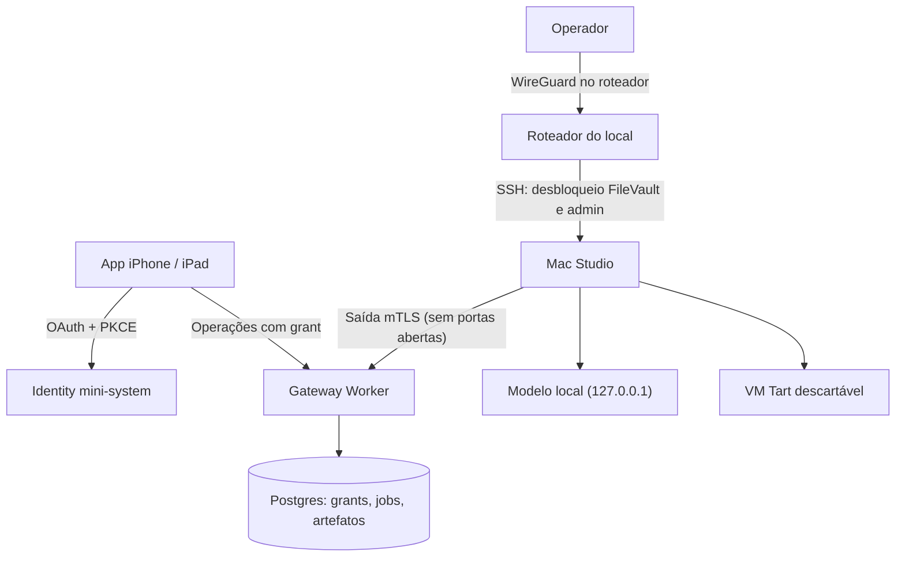

# Mini-system Worker — plano de implementação

> Versão simplificada: sem MDM, sem PKI comercial, sem orquestrador de terceiros.
> Os únicos fornecedores no caminho crítico são a Apple (hardware e macOS) e o local de hospedagem.
> Este documento substitui as versões anteriores do plano do instalador, da infraestrutura e do app.

Status: **plano**. Nada aqui foi homologado em equipamento. Os itens marcados com **[verificar]** dependem de teste ou de documentação atual antes de virar compromisso.

---

## 1. Objetivo

Um Mac Studio remoto (128 GB) que oferece ao mini-system três capacidades **independentes**:

| Capacidade | O que faz | Depende de |
|---|---|---|
| **Inferência** | Modelo local servido pelo gateway do mini-system | Worker (daemon) |
| **Runner Linux** | Jobs em VM Linux arm64 descartável | Worker + Tart + sessão de usuário |
| **Runner macOS** | Build e testes Xcode em VM macOS descartável | Worker + Tart + sessão de usuário |

Se a virtualização falhar ou exigir intervenção, a inferência continua. Um job de CI roda com o modelo desligado.

O usuário opera tudo pelo app iPhone/iPad do mini-system, entrando pelo Identity existente e limitado pelos grants do workspace.

### Primeiro marco (definição de pronto)

Em um Mac limpo:

1. instalar o worker com o script;
2. inscrever o nó no gateway;
3. conversar com o modelo local pelo gateway, a partir do app;
4. rodar um teste real do mini-system em VM Linux com a IA desligada (`ai: off`);
5. revogar o grant com o app aberto e ver o stream fechar e o próximo job ser recusado.

---

## 2. Princípios

1. **A presença física substitui o MDM.** Quem instala e inscreve o nó é o operador, no equipamento. A confiança na máquina nasce desse ato, e não de atestação.
2. **Um host, uma fila, uma autoridade.** O gateway do mini-system é o único coordenador. Nada de segundo orquestrador enquanto houver um único Studio.
3. **Ferramentas embutidas antes de ferramentas novas.** `ssh-keygen`, `openssl`, `launchd`, `fdesetup`, `git`, WireGuard.
4. **A VM é descartável; o trabalho não.** O estado persistente vive no Git e no armazenamento do gateway, nunca no disco do Studio.
5. **Adiar até medir.** Registro OCI, segundo host, pool x86, KVM e 5G entram quando houver necessidade medida (seção 14).

---

## 3. Arquitetura



- O **iPhone** fala só com o gateway. Nunca carrega credencial do Mac.
- O **Mac** inicia a conexão com o gateway e busca trabalho. Nenhuma porta pública.
- O **caminho administrativo** (WireGuard → SSH) termina no roteador, fora do Studio, e funciona antes do desbloqueio do FileVault.
- A **VM** não alcança o modelo, o Postgres, a rede de gerenciamento nem o host (seção 10).

---

## 4. O worker no Mac

### 4.1 Processos

| Processo | Tipo launchd | Usuário | Função |
|---|---|---|---|
| `mini-worker` | LaunchDaemon | `_miniworker` (serviço, sem login) | Conexão mTLS, inscrição, renovação de certificado, proxy de inferência, atualizações, `doctor` |
| `mini-runner` | LaunchAgent | `runner` (usuário dedicado, com sessão) | Cria, executa e destrói VMs Tart. Recebe ordens do daemon por socket Unix local |
| servidor de modelos | LaunchDaemon | `_miniworker` | Escuta só em `127.0.0.1`. Implementação a escolher (ex.: llama.cpp ou MLX) |

O runner é LaunchAgent porque o Tart/Virtualization.framework em modo headless pode exigir o chaveiro de login desbloqueado, o que só existe com o usuário logado. **[verificar]** no boot frio (seção 12).

### 4.2 Layout em disco

```
/opt/mini-worker/
  releases/<versão>/bin/{mini-worker,mini-runner}
  current  -> releases/<versão>
  previous -> releases/<versão anterior>
  allowed_signers            # chave pública de release (vem no instalador)
/var/mini-worker/            # 0700, dono _miniworker
  node.key  node.crt  ca.crt
  catalog/<sha256>           # modelos e imagens, endereçados pelo hash
  state.json
/Library/LaunchDaemons/app.minisystem.worker.plist
/Users/runner/Library/LaunchAgents/app.minisystem.runner.plist
```

---

## 5. Instalação

O instalador é **um script + um tarball**, não um `.pkg`. O mesmo instalador serve para todos os nós.

```sh
# no Mac, como administrador
curl -fsSLO https://<gateway>/worker/install.sh
curl -fsSLO https://<gateway>/worker/install.sh.sig
ssh-keygen -Y verify -f allowed_signers -I release@mini-system \
  -n mini-worker -s install.sh.sig < install.sh
sudo sh install.sh
```

O `allowed_signers` é distribuído fora de banda (impresso no runbook / gerenciador de senhas) na primeira instalação. A partir daí, ele vem no próprio pacote.

O script:

1. verifica arquitetura (`arm64`) e versão do macOS mínima;
2. baixa o tarball e confere a assinatura (`ssh-keygen -Y verify`) e o sha256 do manifesto;
3. cria `_miniworker` e `runner`, aplica permissões;
4. extrai em `releases/<versão>`, aponta `current`, instala os plists, `launchctl bootstrap`;
5. roda `mini-worker doctor` e mostra o resultado.

**Por que não `.pkg` notarizado:** arquivos baixados por `curl`/`scp` não recebem o atributo de quarentena, então o Gatekeeper não os bloqueia. A integridade vem da assinatura própria, verificada pelo script e pelo worker. Isso dispensa conta de desenvolvedor, notarização e MDM. Se um dia houver MDM, o `.pkg` pode embrulhar este mesmo tarball.

### Chave de release

- Par `ed25519-sk` gerado num YubiKey (`ssh-keygen -t ed25519-sk`), namespace `mini-worker`.
- Fica com o operador, **nunca** no gateway nem no CI.
- Uma segunda chave de reserva, também em hardware, guardada offline e já listada no `allowed_signers`.

---

## 6. Inscrição e identidade da máquina

### 6.1 CA própria

- **Raiz** offline (`openssl`, chave no YubiKey ou em mídia guardada). Usada só para assinar a intermediária.
- **Intermediária** no gateway, em cofre de segredos, assina certificados de nó.
- Certificados de nó com validade de **7 dias**, renovados automaticamente quando restar metade.

Certificado curto substitui CRL/OCSP: revogar um nó = bloquear a renovação no gateway e, opcionalmente, pôr o serial numa lista de negação até expirar.

### 6.2 Fluxo

1. No app (ou console do gateway), o operador cria um **código de inscrição**: uso único, 10 minutos, vinculado a um nome de nó e às capacidades permitidas.
2. No Mac: `sudo mini-worker enroll <código>`.
3. O worker gera a chave **localmente** (P-256, `0600`, dono `_miniworker`; Secure Enclave se o binário suportar — **[verificar]** acesso por daemon sem sessão) e envia o CSR com o código.
4. O gateway valida o código, consome-o, assina e devolve `node.crt` + `ca.crt`.
5. O worker abre a conexão mTLS e passa a buscar trabalho.

A chave privada nunca sai do Mac. Um Mac clonado ou roubado deixa de funcionar em até 7 dias, ou imediatamente se o operador bloquear o nó.

### 6.3 O que o gateway sabe do nó

`workers(id, nome, capacidades, cert_serial, ultima_renovacao, estado_doctor, bloqueado_em)`

---

## 7. Atualização e rollback

Um único mecanismo para o worker, os modelos e as imagens de VM.

### 7.1 Manifesto

```json
{
  "seq": 42,
  "issued_at": "2026-12-01T10:00:00Z",
  "worker":  { "version": "0.4.0", "sha256": "…", "url": "…" },
  "models":  [ { "id": "chat-default", "version": "2026-11", "sha256": "…", "url": "…" } ],
  "images":  [
    { "profile": "linux-ci",  "name": "linux-arm64-base",  "version": "3", "sha256": "…" },
    { "profile": "macos-ci",  "name": "macos-arm64-xcode", "version": "1", "sha256": "…" }
  ],
  "revoked": [ "sha256:…" ]
}
```

- Assinado com a chave de release (`manifest.json.sig`).
- `seq` só cresce: o worker recusa manifesto com `seq` menor que o último aceito (proteção contra rollback forçado por terceiros).
- O gateway serve os arquivos como estáticos. Não há catálogo de terceiros.

### 7.2 Aplicação

1. Baixar para `catalog/<sha256>`, conferir hash.
2. Worker: extrair em `releases/<nova>`, `previous -> current`, `current -> nova`, reiniciar serviços.
3. Teste de saúde (conecta ao gateway, `doctor` ok, inferência responde).
4. Falhou em 2 minutos → `current -> previous`, reiniciar, reportar.

Modelos e imagens seguem a mesma regra: a versão anterior fica no disco até a nova passar no teste. Um hash listado em `revoked` não inicia mesmo que esteja em cache.

---

## 8. Endurecimento sem MDM — `mini-worker doctor`

Executado na instalação, a cada hora e a cada atualização. Resultado enviado ao gateway.

| Verificação | Esperado |
|---|---|
| FileVault | ligado (`fdesetup status`) |
| SIP | ligado (`csrutil status`) |
| Firewall da aplicação | ligado, modo furtivo |
| Atualizações automáticas de segurança | ligadas |
| Login remoto (SSH) | ligado, só chave, só a partir da rede do roteador |
| Compartilhamento de tela / arquivos | desligados |
| Permissões de `/opt/mini-worker` e `/var/mini-worker` | dono e modo corretos |
| Espaço livre | acima do limite configurado |
| Partida ao voltar energia | ligada (`pmset autorestart 1`) |

**Política do gateway:** nó com verificação crítica falhando é colocado em `quarentena` (não recebe jobs; inferência configurável). O `doctor` **relata**, não impõe. Isso é a principal diferença de um MDM — aceitável porque só o operador tem senha de administrador.

**Chave de recuperação do FileVault:** gerada na ativação, guardada pelo operador no gerenciador de senhas. Não fica no gateway.

---

## 9. Imagens e perfis de execução

### 9.1 Imagens

| Imagem | Conteúdo | Uso |
|---|---|---|
| `linux-arm64-base` (VM Tart) | Linux LTS mínimo, usuário de job sem sudo, Podman ou Docker Engine no guest, agente do runner | Um Linux limpo por job |
| `mini-system-ci` (container OCI, roda **dentro** da VM Linux) | Node e Deno nas versões do CI, utilitários de build, navegadores da suíte. Postgres/Supabase local quando o teste exigir, com versões fixadas | Ambiente reprodutível da suíte do mini-system |
| `macos-arm64-xcode` (VM Tart) | macOS + Xcode em combinação homologada, simuladores usados, agente do runner. **Sem certificados de assinatura** | Build e testes do app iPhone/iPad |

### 9.2 Como uma imagem é produzida (sem Packer e sem registro)

- Receita = script versionado no repositório (`images/<nome>/build.sh`) que chama `tart clone`, `tart run`, `tart exec`.
- O build roda **no próprio Studio**, numa janela sem jobs.
- Candidata aprovada quando: (a) a suíte real do mini-system passa (Linux) ou um projeto iOS representativo compila e testa (macOS); (b) a lista de versões das ferramentas é gravada.
- Aprovação = o operador adiciona o sha256 da imagem ao manifesto e assina. Imagem base nunca é atualizada a partir do disco de um job.
- Bases de terceiros (imagem Linux, imagens de serviços) fixadas por digest; a VM macOS parte de mídia oficial da Apple.

### 9.3 Perfis

O job pede um **perfil**; o gateway resolve o perfil para uma imagem aprovada e limites. A label pedida indica capacidade, não concede acesso.

| Perfil | Para quê | Rede | Credenciais | Código de entrada |
|---|---|---|---|---|
| `linux-ci` | Testes de código interno revisado | Saída só para registros de pacotes aprovados | Token temporário de leitura do repositório, se necessário | Commit autorizado |
| `macos-ci` | Build/testes Xcode internos | Idem | Idem | Commit autorizado |
| `untrusted` | **Código gerado pelo modelo ainda não revisado** | **Nenhuma** (sem interface) | **Nenhuma** | Cópia do commit + patch, montada só-leitura e copiada para dentro |
| — | PR de terceiros | Não roda no Studio. Runners hospedados do GitHub, se aplicável | — | — |
| — | Assinar, publicar, deploy | Não roda no Studio. Workflow protegido com OIDC | — | — |

O perfil `untrusted` existe para que o modo assistido funcione: o modelo propõe um patch, a suíte roda numa VM sem rede e sem segredos, o usuário revisa o resultado. Os riscos principais de código não revisado — exfiltração e roubo de credencial — ficam bloqueados. O risco residual é escape do hipervisor, aceito para código produzido pelo próprio modelo sobre repositórios próprios. Dependências são resolvidas **antes**, a partir do lockfile, por um passo com rede que não executa o patch.

---

## 10. Isolamento da VM

- **Rede negada por padrão.** `untrusted` sem interface. Perfis com rede usam regras `pf` no host: só DNS controlado e destinos da lista, sem rota para o host, o servidor de modelos, a LAN do local, o roteador ou outros guests. Testar IPv4, IPv6 e DNS. O Softnet do Tart, na configuração padrão, permite IPv4 público e o gateway da bridge — não confiar no padrão. **[verificar]**
- **Sem compartilhamentos:** nada de pasta pessoal, sockets do host, agente SSH, dispositivos USB ou montagens arbitrárias.
- **Uma VM ativa por vez** no começo. Sem superalocação de RAM.
- **Destruição garantida:** após sucesso, erro, timeout ou cancelamento, `tart delete`. Ao iniciar, o runner apaga qualquer VM órfã.
- **Licença:** o macOS permite até 2 instâncias macOS virtualizadas adicionais por Mac, para fins como desenvolvimento e teste. O Tart (FSL) permite uso interno. **[verificar]** os termos da versão instalada.

### Orçamento de memória (128 GB)

Regra de admissão:

```
pico_medido_inferência + RAM_da_VM + reserva_macOS (20 GB) + margem (≥ 16 GB) ≤ 128 GB
```

| Perfil | Alocação inicial |
|---|---|
| `linux-ci` / `untrusted` | 4 vCPU, 8–12 GB |
| `macos-ci` | 4–6 vCPU, 16–24 GB |
| Inferência | reserva = pico medido com o modelo, contexto máximo e concorrência de produção |

Exemplo: inferência 64 GB + VM macOS 24 GB + reserva 20 GB = 108 GB → margem 20 GB, admitido. Se a inferência medir 90 GB, o job espera.

Além da RAM, medir latência p95 da inferência e uso do SSD com um build rodando. Se o p95 piorar além do limite acordado, o job é pausado ou o perfil reduzido. Inferência tem prioridade.

---

## 11. Fila, workspaces e IA

### 11.1 Fila (Postgres do mini-system)

```
jobs(id, workspace_id, perfil, commit, ai_mode, status, criado_por, grant_id,
     worker_id, iniciado_em, terminado_em, imagem_sha256, resultado)
artifacts(id, job_id, nome, sha256, tamanho, url, expira_em)
```

- Criar o job e enfileirar na mesma transação.
- Com um worker, `SELECT … FOR UPDATE SKIP LOCKED` basta. Reservas renováveis e numeração de tentativas entram junto com o segundo host.
- O worker publica o resultado com o `imagem_sha256` usado: o app mostra exatamente qual ambiente rodou.

API do gateway: `POST /jobs`, `GET /jobs/{id}`, `GET /jobs/{id}/stream`, `POST /jobs/{id}/cancel`.

### 11.2 Workspace retomável = branch Git

- Pausar: o runner faz commit e push para `wip/<workspace>/<timestamp>` num repositório privado e destrói a VM.
- Retomar: VM nova a partir da imagem aprovada, clone do último `wip/…`, reinstalação de dependências pelo lockfile.
- Sobrevive à perda do SSD do Studio sem nenhum armazenamento novo. Um único escritor é garantido pela própria fila (um worker).
- Credenciais nunca entram no commit; caches são locais e descartáveis.

### 11.3 Modos de IA

| Modo | Comportamento |
|---|---|
| `off` | Fluxo normal de CI. Funciona com o modelo desligado. |
| `assist` | O modelo recebe só o contexto que o grant permite, produz diagnóstico ou patch como **artefato**. Executar o patch → job no perfil `untrusted`. |

O modelo nunca recebe credencial de infraestrutura, de assinatura ou de deploy. A VM não fala com o modelo; o gateway faz a ponte.

---

## 12. Boot frio e recuperação

| Situação | Caminho |
|---|---|
| Reinício planejado (atualização do macOS) | `sudo fdesetup authrestart` — o próximo boot passa o FileVault uma vez |
| Queda de energia / travamento | `pmset autorestart 1` liga o Mac; operador conecta pelo WireGuard do roteador e destrava o FileVault por SSH no pré-boot (recurso do macOS 26). **[verificar]** no equipamento e versão finais, após corte real |
| SSH de pré-boot não funciona | Plano B: técnico do local + KVM-IP comprado só nesse caso |
| Mac não responde nem ao religamento | Técnico religa a tomada; se necessário, DFU com cabo USB-C e um segundo Mac |

**Ordem de volta dos serviços após o desbloqueio:**

1. LaunchDaemons sobem → `mini-worker` reconecta → **inferência disponível**.
2. Runner exige sessão do usuário `runner`. **[verificar]** se o desbloqueio por SSH já abre essa sessão. Se não, o operador abre a sessão (SSH + script) e o runner volta.
3. Enquanto o runner não volta, o gateway marca as capacidades `linux`/`macos` como indisponíveis e mantém os jobs na fila.

Métrica de aceite: **tempo do corte de energia até a primeira inferência** e **até o primeiro job Linux**.

---

## 13. App iPhone/iPad

Referência de experiência: WhisperCode (cliente iOS de sessões de código com ditado). A identidade, os grants e o histórico são do mini-system.

### 13.1 Login e autorização

- Cliente OAuth **público** no Identity, `ASWebAuthenticationSession` + PKCE (RFC 8252).
- Token com audiência do gateway do worker. **[verificar]** a vinculação de audiência e a validação hospedada, ainda pendentes no contrato atual do Identity.
- Cada operação é checada no gateway contra o grant vigente (membro, cliente, workspace, operações, expiração).

Operações novas a acrescentar ao catálogo do Registry:

| Operação | Libera |
|---|---|
| `worker.chat` | Conversar com o modelo local |
| `worker.chat.context` | Enviar arquivos do projeto ao modelo |
| `worker.job.linux` | Criar jobs `linux-ci` / `untrusted` |
| `worker.job.macos` | Criar jobs `macos-ci` |
| `worker.job.read` | Ler status, logs e artefatos dos jobs do workspace |
| `worker.workspace.resume` | Pausar e retomar workspaces |
| `worker.terminal` | (fase posterior) terminal interativo numa VM específica |

Revogar o grant corta novas operações **e** fecha streams abertos (o gateway reavalia o grant a cada mensagem do stream ou a cada 30 s).

### 13.2 Telas

| Modo | O que acontece |
|---|---|
| **Conversar** | Pedido (digitado ou ditado) vai ao modelo; resposta em streaming. |
| **Executar** | Escolhe uma tarefa aprovada ("Testar em Linux", "Build iOS"); acompanha fila, logs, artefatos. Funciona sem IA. |
| **Trabalhar com IA** | Modelo propõe patch → usuário revisa o diff → autoriza o teste (`untrusted`) → vê o resultado. |

- Cada execução mostra commit, perfil, versão da imagem e status.
- Perda de sinal não afeta o trabalho; ao reconectar, o app recupera o histórico.
- Studio offline: histórico e último checkpoint continuam visíveis.
- Ditado: reconhecimento de fala no próprio aparelho (Speech framework ou WhisperKit).

O OpenCode pode ser usado como motor de sessão **dentro da VM** num protótipo. Seu servidor nunca é exposto diretamente; o acesso passa pelo gateway.

---

## 14. Infraestrutura física

### 14.1 Local

Colocation com: prateleira no rack, **tomada religável remotamente** (incluída no serviço), energia protegida, técnico 24/7 e acordo escrito sobre tempo de resposta, custódia do equipamento e procedimento de intervenção (o técnico nunca recebe a chave do FileVault). Uma sala própria serve se tiver acesso restrito, refrigeração contínua e alguém que chegue dentro do prazo de recuperação.

### 14.2 Compras mínimas

| Qtde. | Item | Observação |
|---|---|---|
| 1 | Mac Studio 128 GB, SSD 4 TB | Homologar um Studio existente primeiro, se houver. **[verificar]** configuração disponível na compra |
| 1 | Roteador/firewall pequeno com WireGuard | Termina o caminho administrativo fora do Studio. Configuração exportada e guardada |
| 1 kit | Cabos etiquetados, cabo USB-C de dados para DFU | Deixado no local |

### 14.3 Adiado até haver necessidade medida

| Item | Gatilho para entrar |
|---|---|
| KVM-IP (ex.: PiKVM) | SSH de pré-boot falhar no teste |
| Segundo uplink / 5G | Prazo de recuperação exigir; local permitir |
| PDU própria, nobreak | Sala própria sem esses serviços |
| Switch com VLANs | Mais de um equipamento no local |
| Registro OCI + assinatura de imagens com Cosign | Segundo host |
| Reservas/tentativas na fila | Segundo host |
| Pool Linux x86 / servidor dedicado | Builds x86 frequentes medidos |
| Mac dedicado de CI | Fila de builds macOS atrapalhando a inferência |
| Runner JIT do GitHub Actions | Necessidade de CI privado disparado pelo GitHub |

---

## 15. Marcos e testes de aceitação

### M1 — Bancada (no escritório)

- [ ] Instalação pelo script em Mac limpo; `doctor` verde.
- [ ] Inscrição com código de uso único; código reutilizado é recusado.
- [ ] Bloquear o nó → próxima renovação falha; desbloquear → volta.
- [ ] Conversa com o modelo pelo app, via gateway.
- [ ] Imagens `linux-arm64-base` + `mini-system-ci` aprovadas; suíte real do mini-system passa com `ai: off`.
- [ ] Job seguinte não herda arquivos, processos nem credenciais do anterior.
- [ ] VM sem acesso ao host, ao modelo, à LAN, por IPv4, IPv6 e DNS.
- [ ] Revogar o grant com stream aberto → stream fecha; novo job recusado.
- [ ] Atualização com teste de saúde falhando → rollback automático.
- [ ] Manifesto com `seq` antigo → recusado. Imagem em `revoked` → não inicia.
- [ ] Tirar da tomada → religar → desbloquear FileVault por SSH via WireGuard → inferência volta → runner volta. Tempos registrados.

### M2 — No local

- [ ] Corte de energia real; religamento remoto da tomada; mesmos tempos medidos.
- [ ] Queda do link: túnel volta sozinho.
- [ ] Técnico ensaia o procedimento físico sem receber segredos.

### M3 — macOS

- [ ] Imagem `macos-arm64-xcode` aprovada; build e testes do app iPhone/iPad passam.
- [ ] Carga combinada: inferência com contexto e concorrência de produção + build macOS. p95 dentro do limite.

### M4 — Modo assistido

- [ ] Modelo propõe patch; app mostra o diff; teste roda em `untrusted` sem rede e sem credenciais; resultado volta ao app.
- [ ] Pausar e retomar um workspace pelo branch `wip/…`.

---

## 16. Riscos e pendências

| Item | Risco | Ação |
|---|---|---|
| Desbloqueio do FileVault por SSH | Recurso novo; condições específicas | Testar com corte real (M1) antes de levar ao local |
| Sessão do usuário `runner` após boot | Runner não volta sozinho | Medir no M1; script de abertura de sessão via SSH |
| Chave do nó no Secure Enclave por daemon | Pode não funcionar sem sessão | Começar com chave em arquivo `0600`; avaliar SE depois |
| Softnet/`pf` | Configuração padrão permissiva | Testes de bloqueio no M1 |
| Licença do Tart e do macOS | Mudança de termos | Revisar antes de cada atualização de versão |
| Sem atestação de hardware | Nó falso poderia se inscrever com código vazado | Código de uso único, 10 min, criado pelo operador presente |
| `doctor` só relata | Admin local pode desligar proteções | Quarentena automática; só o operador tem senha de admin |
| Audiência do token no Identity | Pendente no contrato atual | Fechar antes de expor o gateway ao app |
